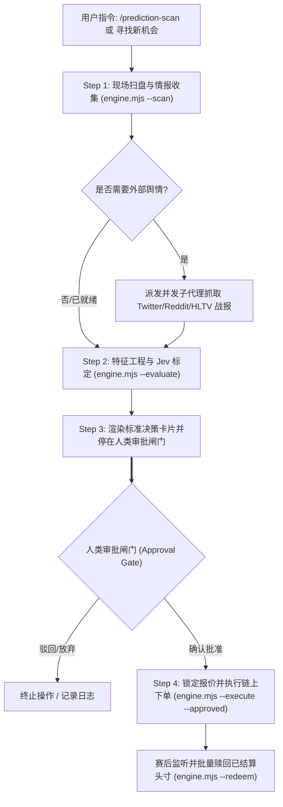

# 预测市场高确定性量化决策工作流 (Prediction Quant Skill)

本技能为 **Binance Agentic Nexus (BAN)** 专属的预测市场量化决策套件。采用工业级特征工程规范，全面消除粗糙自然语言打分和幻觉，为 CEX/Web3 预测市场操作提供具备数学期望优势 (+EV) 的闭环决策。

---

## 零 Demo 与反虚构数据铁律 (Anti-Hallucination Guardrail)

> [!CAUTION]
> **绝对禁止任何形式的预置 Demo 与虚构数据！**
> 1. **严禁捏造假标的**：绝不允许在代码、输出或提示词中出现任何硬编码假赛事、战队或虚构盘口；
> 2. **真实接口直通**：所有盘口标的必须由 `engine.mjs --scan` 现场向真实的 BAW 接口请求；若 BAW 钱包未登录，必须如实向用户报错并提示执行 `baw auth signin`，严禁使用任何模拟假数据伪装已完成扫盘；
> 3. **禁止口算推演**：欧赔去水胜率、盘口错配基点与 EV 必须由 `engine.mjs` 内置数学算子确定性计算，剥夺大模型口算与算术幻觉的借口。

---

## 快速使用命令 (CLI Cheat Sheet)

```bash
# 1. 扫描现场真实高流动性赛事盘口 (要求 BAW 已登录)
node .agents/skills/custom/prediction-quant/scripts/engine.mjs --scan --l1Category esports --limit 5

# 2. 调用 Jev 结构化概率标定与 EV 测算 (必须传入现场真实特征工程 JSON)
node .agents/skills/custom/prediction-quant/scripts/engine.mjs --evaluate --json '<JSON_STRING>'

# 3. 链上深度询价
node .agents/skills/custom/prediction-quant/scripts/engine.mjs --quote --tokenId <id> --marketTopicId <id> --amount 1.0

# 4. 执行链上下单 (强制必须带有 --approved 显式审批参数)
node .agents/skills/custom/prediction-quant/scripts/engine.mjs --execute --quoteId <id> --approved

# 5. 胜出头寸自动兑付赎回
node .agents/skills/custom/prediction-quant/scripts/engine.mjs --redeem --tokenIds <id1,id2>

# 6. 内核纯数学算子与安全闸门自检 (无业务假数据)
node .agents/skills/custom/prediction-quant/scripts/engine.mjs test
```

---

## 四步标准量化作业程序 (4-Step SOP)



### Step 1: 现场扫盘与情报搜集 (Scan & Intelligence)
1. 运行 `node .agents/skills/custom/prediction-quant/scripts/engine.mjs --scan` 获取现场流动性合规盘口；
2. 若需外网赛事突发情报（如替补、变阵、背靠背疲劳），可派发 1~2 个 `research` 子代理搜集外网真实战报，提炼出 `polarScore`（-1.0 ~ +1.0）、`rosterRisk`（0.0 ~ 1.0）、`fatigueRisk`（0.0 ~ 1.0）；
3. **禁止臆测**：无外部数据时，保持默认安全值（`rosterRisk: 0.1`）。

### Step 2: 特征工程与 Jev 标定 (Feature Engineering & Calibration)
1. 将现场盘口价格、外网尖头去水真实胜率（`Pinnacle` 欧赔转换）及舆情因子装配为 `PredictionTradeState`；
2. 将该真实 State JSON 传入 `engine.mjs --evaluate --json '...'`（底层由 `typesafe-evaluator` 的 `jev-latest` 驱动，带有本地 Pre-flight 静态自愈与确定性 EV 计算）；
3. 输出标准化量化指标：Jev 校准胜率、错配基点（Discrepancy bps）、期望价值（EV %）、风险评级。

### Step 3: 标准决策卡片与人类审批闸门 (Approval Gate)
**铁律：涉及真实资金交易，绝对禁止私自越权开仓！必须先输出标准卡片，等待人类输入确认指令：**

| 候选赛事与选项 | 盘口买价 | 盘口隐含胜率 | 尖头盘真实概率 | Jev 标定胜率 | 期望收益 (EV %) | 风险分 | 决策建议 |
| :--- | :--- | :--- | :--- | :--- | :--- | :--- | :---: |
| **<现场真实赛事与标的选项>** | <实时买价> | <隐含胜率> | <去水真实胜率> | <Jev胜率> | **<期望收益%>** | <风险分> | <决策判定> |

* 展示完成后，主动提示用户：
  > *“已完成 Jev 特征工程与期望价值测算。该方案具备正期望与错配优势。下注金额由您决定（若未声明，系统将默认按 1.00 USDT 试探性执行）。如同意开仓，请回复【确认买入】或指定金额如【确认买入 5 USDT】，我将为您锁定报价并提交链上成交。”*

### Step 4: 锁定报价与链上闭环 (Quote, Execute & Redeem)
1. 收到用户明确批准后，调用 `engine.mjs --quote`（传入用户指定金额 `--amount <amt>`，未声明则默认 1.0）获取 `quoteId` 锁定深度与滑点；
2. 传入 `--approved` 参数执行 `engine.mjs --execute --quoteId <id> --approved`；
3. 比赛结算后，自动运行 `engine.mjs --redeem --tokenIds <id>` 完成链上自动兑付。

---

## 核心风控红线 (Risk Guardrails)

1. **下注金额由人工决定**：下注量必须由人类明确指定；若用户在审批确认中未明确声明具体金额，系统默认按 **1.00 USDT** 执行，严禁 Agent 自主超额加注；
2. **严禁同场对冲内耗**：绝对禁止在同一场比赛两个对立方向分别下注（`allowed.optB: false`）；
3. **临时文件卫生**：任何临时性测试脚本必须存放于 `tmp/`，测试完成后立即物理删除；
4. **机密脱敏**：任何日志或汇报严禁打印 `.env` 内真实秘钥明文。

---

## 深度技术参考 (References)

- [`jev_prompt_guide.md`](references/jev_prompt_guide.md) — 结构化特征工程与 "Inputs" 引导语法构造指南
- [`risk_rules.md`](references/risk_rules.md) — 预测市场实盘全周期复盘提炼之风控军规
