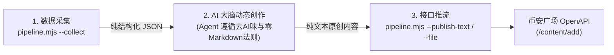

# 币安广场【内容挖矿】解耦工作流 (Square Mining Workflow)

本技能按照 Google Antigravity 官方技能规范设计，采用**数据采集、AI 大脑创作、接口推流三层解耦架构**。

> [!IMPORTANT]
> **绝对准则：严禁将文案或文章硬编码在脚本文件中！**  
> 脚本是永久只读的通用基础设施工具。每次发帖绝不需要修改或覆写任何代码文件，实现 **0 脚本改动、100% 动态原创发帖**。

---

## 一、三层解耦运行架构



1. **第一层：数据采集（只读稳健）**  
   运行 `pipeline.mjs --collect` 统一抓取：
   - 传统顶级金融媒体源（CNBC、Yahoo Finance、MarketWatch）即时头条，动态提炼宏观与财经热点议题（彻底移除失效的网页端广场爬虫）；
   - 官方 `crypto-market-rank` Web3 聪明钱净流入榜（smart-money-inflow）与链上代币热度榜（social-hype）；
   - CEX 现货价格、24h 涨跌幅与合约最新资金费率；
   - 传统权威财经与加密头部机构（The Block、CoinTelegraph、CoinDesk）要闻。
2. **第二层：AI 动态原创（大模型思考）**  
   由 Agent 读取采集到的客观事实与盘面数据，现场动态构思与撰写：
   - 严格遵循 [`copywriting_rules.md`](./references/copywriting_rules.md)；
   - **零 Markdown 格式**（严禁 `**`、`#`、`-`、装饰 Emoji 列表）；
   - **Cashtags $\le$ 3**（如 `$BTC`、`$ETH`）；
   - 第一人称真人交易员视角，冷峻、干脆、反平庸，杜绝一切固定模板与 AI 翻译腔。
3. **第三层：内容推流（通用发布）**  
   通过参数或临时文件直接调用推流接口，一键完成发布。

---

## 二、Agent 标准执行 SOP（极简 3 步）

当用户发出发帖或内容挖矿指令时，Agent 应按以下步骤操作：

### 步骤 1：采集实时数据
```bash
node .agents/skills/custom/square-mining/scripts/pipeline.mjs --collect
```
解析输出中 `===== DATA_JSON_START =====` 与 `===== DATA_JSON_END =====` 之间的 JSON 内容，获取一手资讯。

### 步骤 2：AI 动态创作
Agent 结合最新盘面与要闻事实，在上下文中完成 100% 纯原创写作，生成适合广场传播的短动态（250~400 字）或长文章。

### 步骤 3：直接推流发布
```bash
# 方式 A：直接传参推流
node .agents/skills/custom/square-mining/scripts/pipeline.mjs --publish-text "动态正文内容..."

# 方式 B：通过临时文件推流（推荐，避开 Shell 换行与引号转义问题）
node .agents/skills/custom/square-mining/scripts/pipeline.mjs --file "/path/to/draft.txt"

# 方式 C：带标题长文章发布
node .agents/skills/custom/square-mining/scripts/pipeline.mjs --file "/path/to/draft.txt" --title "文章标题"
```
若用户需要先审阅，可追加 `--dry-run` 参数输出预览。

---

## 三、目录结构与工具说明

```text
.agents/skills/custom/square-mining/
├── SKILL.md                          # 本说明主文档
├── scripts/
│   └── pipeline.mjs                  # 解耦后的数据采集与推流管线
└── references/
    └── copywriting_rules.md          # 去AI味法则、零Markdown铁律与平台合规规则
```

### `pipeline.mjs` 参数速查表

| 参数 | 说明 | 示例 |
| :--- | :--- | :--- |
| `--collect` | 仅采集全网热搜、盘面与新闻，输出标准 JSON | `node pipeline.mjs --collect` |
| `--publish-text <text>` | 直接推流指定文本动态 | `node pipeline.mjs --publish-text "..."` |
| `--file <path>` | 从文件读取正文并推流 | `node pipeline.mjs --file ./draft.txt` |
| `--title <title>` | 指定标题（自动转为长文章形态） | `node pipeline.mjs --file ./draft.txt --title "深度复盘"` |
| `--dry-run` | 试运行预览模式，不调用 OpenAPI | `node pipeline.mjs --file ./draft.txt --dry-run` |
| `--publish` | 纯脚本环境下的全自动兜底运行（无 Agent 时） | `node pipeline.mjs --publish` |
