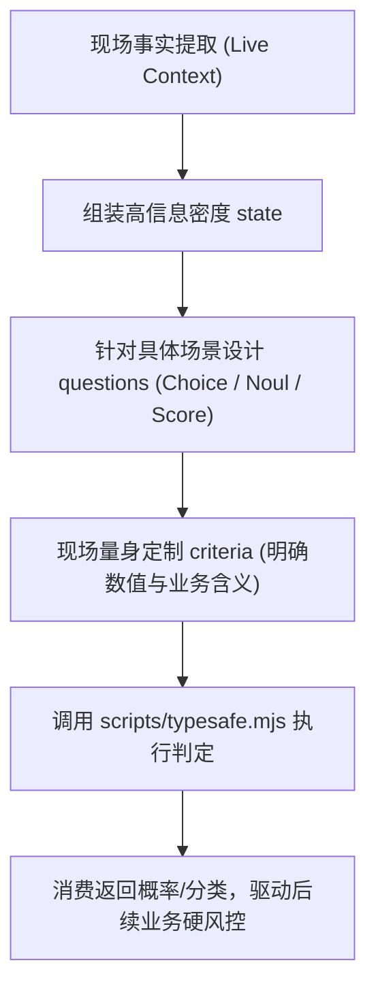

# TypeSafe Evaluator (System One 业务决策裁决器)

本 Skill 是 BAN 系统的自研业务决策与风控裁决器。它将 TypeSafe System One（Jev 模型）的底层能力与币安现货、合约、链上巨鲸跟单及广场内容挖矿等实战业务深度绑定。

> [!IMPORTANT]
> **第一铁律：严禁死板套用硬编码模板！**  
> Agent 绝不能使用千篇一律的固定字符串发起调用。Agent 必须作为具备情景洞察力的大脑，**根据当前面临的具体币种、最新微观盘口指标、推文原文或链上异动现场，实时思考并动态构建定制化的 `state` 与 `questions`**。

---

## 一、四步情景化实时构建范式 (Agent Reasoning Pipeline)

当面临需要客观判定的业务场景时，Agent 必须遵循以下四步实时思考并执行：



### 步骤 1：现场事实聚合并提炼为 `state`
从实时业务环境中提取一手数据，构造结构清晰、信息自洽的 JSON 或 Markdown 上下文：
* **量化交易场景**：聚合当前币种（如 `SOLUSDT`）、最新价、24h 涨跌、当前资金费率、大户多空人数比、主动买入卖出量差额、支撑/阻力位距离；
* **广场内容场景**：传入待机审的推文全文本、提取的 Cashtag、引用的外部新闻标题及信源；
* **链上巨鲸场景**：传入目标代币合约、池子流动性大小、巨鲸地址历史胜率、本次交易占池子比例。

### 步骤 2：精确匹配判定原语
根据下游决策逻辑选择最恰当的原语：
1. **是非概率判定 (`noul`)**：回答“是否属于某种情况”，直接返回 `0.0 ~ 1.0` 的连续概率值（如：*是否存在恶意貔貅特征？*、*当前大跌是否已演化为多头踩踏？*）；
2. **离散方案选择 (`choice`)**：从有限个互斥分类中选出最贴切的一个，并给出概率分布与置信度（如：*行情当前属于哪种状态模式？*、*资金行为属于吸筹还是出货？*）；
3. **梯度程度打分 (`score`)**：在有序的阶梯区间（如 1~5 级）中给出概率加权位置。

### 步骤 3：现场量身定制 `instructions` 与 `criteria`
* **问题必须具体**：严禁写“请分类”，必须指明判定对象与环境背景；
* **选项描述必须有判别力**：在 `criteria` 中写明各个分类在该情境下的具体表征或数值边界。

### 步骤 4：执行调用与结果消费
通过 [`scripts/typesafe.mjs`](../../../scripts/typesafe.mjs) 发起请求并消费返回结果：
```bash
# Agent 将实时思考组装好的完整 JSON 传给执行引擎：
node scripts/typesafe.mjs --json '<Agent动态生成的JSON>'
# 或当内容较长时，先写入 scratch 临时文件再执行：
node scripts/typesafe.mjs --file /path/to/dynamic_payload.json
```

---

## 二、情景化实战思考范例（仅供逻辑参考，切勿机械抄袭）

### 场景 A：真实暴跌下的开仓风控（现场动态构建示例）
当用户或策略在 `BTC` 快速跳水时考虑抄底开多，Agent 实时收集盘口数据，现场生成如下判定请求：

```json
{
  "state": {
    "symbol": "BTCUSDT",
    "event": "15分钟内快速下挫4.2%",
    "spot_vs_perp_delta": "现货出现大额净流出，合约未平仓合约 (OI) 急剧缩减 $1.2B",
    "funding_rate": -0.0185,
    "top_trader_long_short_ratio": 0.58,
    "orderbook_bid_ask_depth_ratio": 0.35
  },
  "questions": {
    "market_regime": {
      "type": "choice",
      "instructions": "Evaluate the underlying driving mechanism of this price drop",
      "criteria": {
        "healthy_pullback": "Normal liquidity absorption, strong bid support at key levels",
        "liquidation_cascade": "Continuous long liquidations wiping out bids, funding rate crashing",
        "structural_bear_break": "Fundamental change in sentiment, sustained institutional distribution"
      }
    },
    "urgent_cut_loss": {
      "type": "noul",
      "instructions": "Is it strictly unsafe to execute a counter-trend long position under current orderbook depth?"
    }
  }
}
```

### 场景 B：币安广场拟真发帖前的机审（现场动态构建示例）
发帖前 Agent 将草稿送审，现场核实事实根据与违规风险：

```json
{
  "state": {
    "draft_text": "美联储或将在下周紧急降息50基点！内部人士透露鲍威尔态度大转弯...",
    "mentioned_assets": ["$BTC", "$ETH"],
    "verified_news_source": "彭博社最新快讯仅提及可能维持利率不变，无任何降息官方表态"
  },
  "questions": {
    "has_misinformation": {
      "type": "noul",
      "instructions": "Does this draft text fabricate or severely exaggerate macro news compared to the verified source?"
    },
    "post_suitability": {
      "type": "choice",
      "instructions": "Determine if this post is compliant with Binance Square trader standards",
      "criteria": {
        "approved": "Objective facts, rational analysis, no sensationalist lies",
        "rejected": "Severe fake news or malicious market manipulation bait"
      }
    }
  }
}
```

---

## 三、优雅降级机制（Optional Fallback）

若发现根目录 `.env` 中未配置 `TYPESAFE_API_KEY`：
1. Agent **绝不报错中止**；
2. Agent 将自身大模型无缝作为本地降级引擎，利用自身上下文推理能力完成上述步骤的逻辑评估；
3. 输出时自然汇报分析结论，并在附注中提示可配置 Key 接入外部 Jev 模型以获得量化标定概率。
